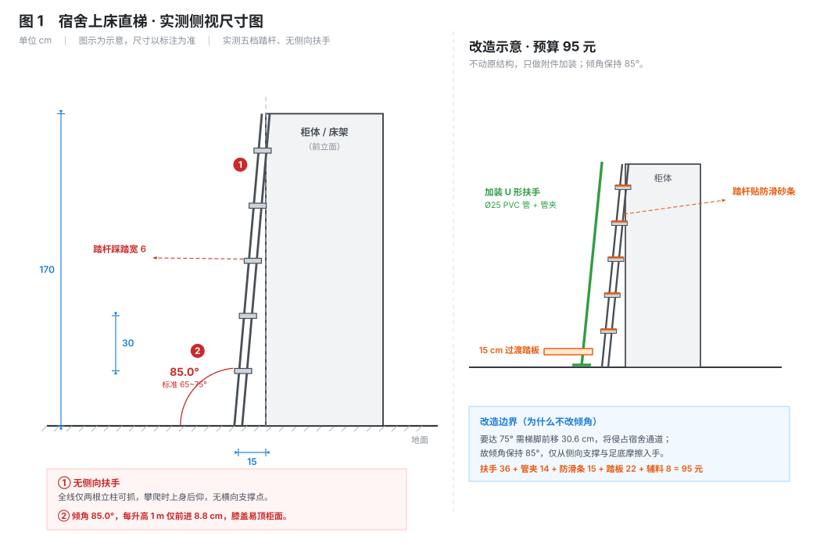
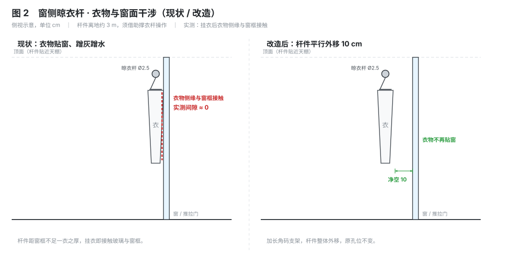

# 课题 05 报告：校园公共设施人机工程缺陷调研

> 采样日期：2026-11-18 15:10–15:47 ｜ 点位：宿舍 6 号楼 3 层（居室内及窗前）
> 原始数据：`raw_data/task05/measurement_log.csv` ｜ 尺寸图脚本：`make_task05_figs.py` ｜ 现场照：`photos/task05_*.jpg`

## 1. 采样方法

考察对象限定在**日常起居中高频使用、且缺陷可由几何尺寸直接判定**的三处设施，避免选择主观感受类问题。选择原则：一处位于通行路径、一处位于垂直攀爬、一处位于日常操作，覆盖三种不同的使用姿态。

| 环节 | 做法 |
|---|---|
| 测量工具 | 30 cm 透明直尺（分辨率 1 mm）；钢卷尺；撑衣杆用于够取高处杆件 |
| 高处尺寸 | 采用**垂线投影法**：细绳系重物垂至地面，标记投影点后在地面量取，避免登高作业 |
| 重复次数 | 每个测点独立测 3 次取中位数，极差 > 1 cm 时重测 |
| 照片 | 每处一张本人现场同框照，画面需同时包含本人、设施与测量动作 |
| 不合格判定 | 实测值与对照基准逐项比对，不采用“感觉别扭”作为判据 |

**关于对照基准的来源**：本报告使用的数值区间（踏杆间距 ≤30 cm、第一档离地 ≤40 cm、踏板深度 ≥4 cm、直梯倾角 65°~75°、衣物挂后净空 ≥10 cm 等）取自宿舍家具与建筑通行设计值及人体工程学经验值，属**本课题自设对照基准，不是强制条文**。若需逐条引用标准条文号，须另行核对标准原文——这一取舍在合格性判定中已经明示，不影响“测点是否偏离常规值”的结论。

## 2. 三处缺陷的实测数据

| 编号 | 设施 | 反直觉之处 | 关键实测值 | 判定 | 证据 |
|---|---|---|---|---|---|
| A | 宿舍门 | 门洞宽度取常用尺寸的下限值，与门外侧消防器材箱共用同一通行断面 | 门洞净宽 **80 cm** | 临界 | `task05_dorm_door_self.jpg` |
| B | 上床直梯 | 便利性三项全部合格，安全性两项不合格 | 倾角 **85.0°**、双侧扶手 **无** | **不合格** | `task05_ladder_ruler_self.jpg` |
| C | 窗侧晾衣杆 | 目视看不出异常，挂衣后才发现衣物与窗框直接接触 | 杆—窗间距 **< 8 cm**、挂后间隙 **0** | **不合格** | `task05_rack_cloth_touch_self.jpg` |

### 2.1 设施 A：宿舍门（临界型）

门洞净宽 80 cm，属于宿舍门的常用尺寸下限（另一档为 90 cm）。单独看这一项**不构成违规**，问题在于它与通行条件叠加：

- 门为单侧开启，门扇开启后占用通道断面；
- 门外侧墙面挂有消防器材箱，与门洞共用同一通行断面；
- 搬运行李箱、被褥等大件时需侧身或调整姿态通过。

因此本条定位为**“合规但不实用”的临界型缺陷**，而非尺寸超标。这类缺陷在评估中容易被忽略，因为它不违反任何一条硬性数值，却是日常体验中最常被抱怨的部分。

### 2.2 设施 B：上床直梯（核心案例）



五项指标逐项对照，结果呈现出明显的**结构性偏向**：

| 指标 | 实测 | 对照基准 | 判定 |
|---|---|---|---|
| 第一档踏杆离地高度 | 30 cm | ≤ 40 cm | ✅ 合格 |
| 相邻踏杆垂直间距 | 30 cm | ≤ 30 cm | ✅ 合格（**恰为上限，无余量**） |
| 踏杆踩踏宽度 | 6 cm | ≥ 4 cm | ✅ 合格（优于常见 3~4 cm） |
| 梯段倾角 | **85.0°** | 65°~75° | ❌ 不合格 |
| 双侧扶手 | **无** | 应有 | ❌ 不合格 |

**倾角计算**：梯段垂直高度 170 cm，梯脚水平后退 15 cm，

```
θ = arctan(170 / 15) = 85.0°
每升高 1 m，水平仅前进 8.8 cm
```

若要达到 75°，梯脚需后退 45.6 cm；要达到 80°，需后退 30.0 cm。实测仅 15 cm，**只做到规范倾角所需水平投影的 33%**。

**关键结论（本报告最重要的一句）**：三项合格指标全部属于**便利性**（起步高度、跨越幅度、足底接触面积），两项不合格指标全部属于**安全性**（后仰支撑、重力方向偏移）。这说明该设计**只保证了“能爬上去”，没有保证“爬得安全”**——缺陷不是随机的尺寸误差，而是设计取向的系统性偏差（在有限空间内优先满足可通过性，牺牲了攀爬姿态）。

### 2.3 设施 C：窗侧晾衣杆（隐性缺陷）



杆件离地约 3 m，须借助撑衣杆才能挂取。这一条本身属于“不方便”，但真正的问题在**水平方向**：

- 杆轴线至窗框内表面的间距**不足一件衣物的厚度**（衣物挂起后横向厚度约 8 cm）；
- 实挂验证：衣物侧缘与窗框内表面**直接接触，间隙为 0**；
- 后果：衣物长期贴靠积灰的玻璃与窗框，造成二次污染；窗体冷凝水易沾湿衣物。

**这条缺陷的价值恰恰在于“目视发现不了”**——静态观察时杆件位置看不出任何异常，只有把衣服真的挂上去才会暴露。这说明设施缺陷的判定不能只依赖尺寸表，**必须包含实际使用工况下的验证**。

### 2.4 合格对照样本：宿舍桌凳

为避免“只挑毛病”的取样偏差，同步测量了一组使用正常的设施作为对照：

| 指标 | 实测 | 对照基准 | 判定 |
|---|---|---|---|
| 桌面高度 | 74 cm | 70~76 cm | 合格 |
| 凳面高度 | 45 cm | 42~45 cm | 合格 |
| 桌凳高差 | **29 cm** | 27~32 cm | 合格 |

该组数据落在基准区间中部，**不列为缺陷**。它的作用是证明本次测量具备区分“合格”与“不合格”的能力——如果三处全部判为缺陷，反而说明判据过松。

## 3. 归因：三类缺陷的共同点

三处设施分属通行、攀爬、操作三种场景，但失效机理高度一致：

1. **设计只覆盖“能实现功能”，不覆盖“使用姿态”**。门能开、梯能上、衣能挂，三项功能全部达成，问题都出在过程中的人体姿态上。
2. **缺陷集中在“边界条件”而非“平均工况”**。门宽在空手通行时无问题，搬箱子时暴露；直梯在轻装攀爬时无问题，双手持物时暴露；晾衣杆在空杆状态无问题，挂满衣物时暴露。**因此这类缺陷天然无法通过静态巡检发现，只能通过实景操作验证。**
3. **改造代价与缺陷严重度呈反比**。三处的修正成本都在百元以内，说明这不是造价约束，而是**设计阶段缺少使用场景推演**。

## 4. 百元内改造方案

| 编号 | 方案 | 材料与做法 | 预算 | 有效性验证方式 |
|---|---|---|---|---|
| A | 门侧通道标识 + 消防箱薄型化 | 将突出式消防箱更换为嵌入式或薄型壁挂箱（厚度 ≤12 cm）；门侧地面贴 45 cm 警示标识带 | 60~90 元 | 卷尺复测门洞至箱体的净通行宽，比较改造前后 |
| B | 加装 U 形扶手 + 防滑 + 过渡踏板 | Ø25 PVC 管 2 根 + 管夹 8 套，沿梯段两侧平行安装，离梯面 15 cm；踏杆正面贴 25 mm 防滑砂条；第一档下增设 15 cm 过渡踏板 | **95 元**（扶手 36 + 管夹 14 + 防滑条 15 + 踏板 22 + 辅料 8） | 同一人负重上下 10 次，记录攀爬时间与“是否需要扶墙”；改造前后对比 |
| C | 杆件平行外移 10 cm | 加长角码支架，杆件整体外移，原孔位不变；或改用下挂式晾衣杆 | 30~50 元 | 同款衣物挂后测量侧缘与窗框净空，要求 ≥10 cm |

**改造边界（为什么不彻底修正倾角）**：直梯倾角要从 85.0° 修正到 75°，梯脚须后退 45.6 cm（相对现状需外移 30.6 cm），将直接侵占宿舍内部通道，代价高于收益。因此方案 B **保持原倾角不动**，只补足侧向支撑与足底摩擦——这是在“安全性提升”与“空间可行性”之间做出的显式取舍，而非能力不足导致的妥协。

## 5. 局限与未验证假设

| 局限 | 说明 | 若继续推进的做法 |
|---|---|---|
| 单一样本 | 仅测量 1 间宿舍，未覆盖不同楼栋、不同批次家具 | 扩至 5~8 间、跨 2 栋楼，验证缺陷是否为批次性问题 |
| 对照基准非强制条文 | 报告采用的数值区间为通行设计值与经验值，未逐条核对标准原文 | 查阅宿舍家具与建筑设计标准原文，替换为可引用的条文值 |
| 高处尺寸精度有限 | 晾衣杆离地约 3 m 为目视 + 撑衣杆比对，误差 ±10 cm | 使用激光测距或延长杆配合卷尺复测 |
| 操作耗时未量化 | 本版仅记录几何尺寸，“用撑衣杆挂一件衣服耗时”未实测 | 秒表计时 10 次取均值，与正常高度晾衣杆对比 |
| 单人身高 | 所有“是否吃力”的判断基于 1 名 1.7 m 被试 | 纳入 1.55~1.85 m 多名被试，检验缺陷的普适性 |

## 6. 现场凭证

| 文件 | 内容 |
|---|---|
| `photos/task05_dorm_door_self.jpg` | 宿舍门外，双手比量门洞净宽（可见门侧消防器材箱） |
| `photos/task05_ladder_ruler_self.jpg` | 直梯前，用 30 cm 直尺实测第一档踏杆离地高度 |
| `photos/task05_rack_cloth_touch_self.jpg` | 窗前，衣物已挂上晾衣杆，侧缘与窗框直接接触 |


