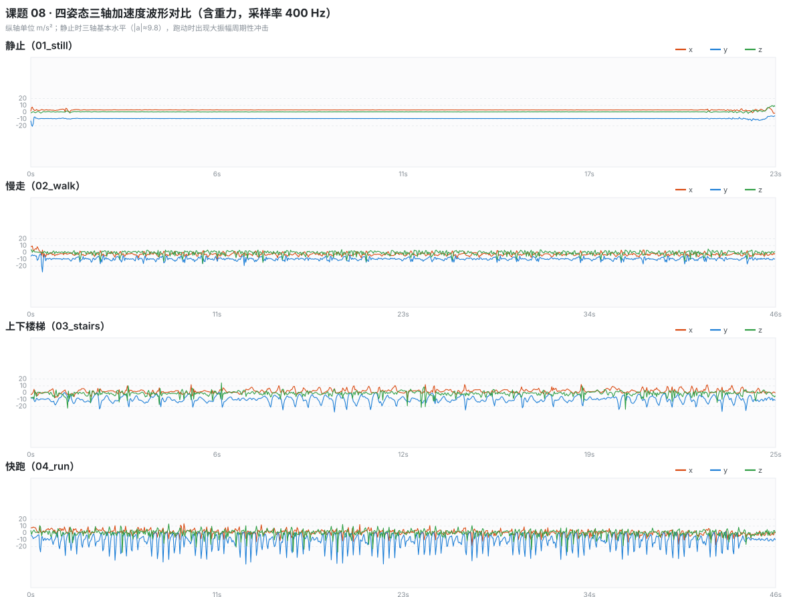

# 课题 08 报告：多姿态步态加速度特征采集与对比

> 采样日期：2026-11-18 14:18–14:31 ｜ 工具：Phyphox 1.2.1（Android） ｜ 原始数据：`raw_data/task08/`
> 分析脚本：`analyze_gait.py`（纯标准库，可一键复现下表全部数字） ｜ 特征表：`features.csv` ｜ 波形图：`task08_waveform.svg`

## 1. 采样设置

| 项目 | 取值 |
|---|---|
| 机型 | Redmi 2407FRK8EC（Xiaomi，Android 16 / HyperOS 3） |
| 加速度计芯片 | lsm6dsvq（ST），量程 ±78.45 m/s²，分辨率 0.0012 m/s² |
| 实验类型 | 加速度（含 g），即含重力分量的原始三轴加速度 |
| 实测采样率 | 399–400 Hz（中位采样间隔 2.50 ms） |
| 手机固定方式 | **右侧裤兜，长边朝下、屏幕贴腿**，四段全程不换位置 |
| 走跑场地 | 教学楼走廊（慢走、快跑），楼梯间上行 1 层后下行（上下楼梯） |
| 单段时长 | 静止 26.8 s / 慢走 49.7 s / 上下楼梯 29.0 s / 快跑 49.6 s |

采样协议：点「开始」→ 手机立刻放回裤兜 → 站定 2 s 让传感器稳定 → 做动作 → 站定 2 s → 点「暂停」→ 导出 CSV → **清空数据**再录下一段。
记录时间戳、机型、传感器参数由 Phyphox 自动写入 `meta/device.csv` 与 `meta/time.csv`，可直接溯源。

## 2. 四状态三轴波形



四个面板**纵轴量程统一为 ±25 m/s²**，可直接横向比较振幅：

- **静止**：三轴几乎水平，x≈3.3、y≈−9.3、z≈0.6，合成 |a|≈9.9，说明手机在兜里是「y 轴朝下」的固定姿态；
- **慢走**：出现 1.9 步/秒的周期性小波动，振幅约 ±5；
- **上下楼梯**：周期性冲击明显放大，y 轴（垂直于地面方向）波动最大（std 4.60），伴随落地的单向尖峰；
- **快跑**：高频大幅冲击，三轴同时剧烈摆动，峰值达 72.5 m/s²（约 7.4 g），幅值约为走路的 4 倍。

## 3. 特征提取

裁剪头尾各 2 s（去掉拿起/放下手机和传感器稳定的毛刺）后的统计量：

| 状态 | 有效时长 | 合加速度均值 | **合加速度标准差** | 峰值 | 步频 | x std | y std | z std |
|---|---|---|---|---|---|---|---|---|
| 静止 | 22.8 s | 9.91 | **0.67** | 22.0 | 0.31 步/s | 0.55 | 0.73 | 0.89 |
| 慢走 | 45.7 s | 10.39 | **2.47** | 32.0 | 1.93 步/s | 2.14 | 2.24 | 2.90 |
| 上下楼梯 | 25.0 s | 10.75 | **4.90** | 38.3 | 2.08 步/s | 2.84 | 4.60 | 3.48 |
| 快跑 | 45.6 s | 12.20 | **9.67** | 72.5 | 2.43 步/s | 3.84 | 9.54 | 5.48 |

**关键观察：四种状态的「合加速度标准差」呈 0.67 → 2.47 → 4.90 → 9.67 的单调递增，相邻档位至少相差 1.8 倍**，且不依赖单条轴的偶然跳动——这说明用「波动强度」作为主判据是稳健的。均值几乎不变（9.9~12.2），说明**只看均值无法区分动作**，必须看方差。这一点是本题最容易被忽略、也最值得写进结论的地方。

## 4. 阈值规则与自查

判别式（单位 m/s²，σ 为裁剪后合加速度 |a| 的标准差）：

```
σ < 1.5                     → 静止
1.5 ≤ σ < 3.5               → 慢走
3.5 ≤ σ < 7.0               → 上下楼梯
σ ≥ 7.0                     → 快跑
```

阈值取在相邻档位的**几何中点附近**（0.67/2.47 → 1.5；2.47/4.90 → 3.5；4.90/9.67 → 7.0），使两侧留出最大裕度。

自查结果：**4/4 段全部判别正确**（由 `python analyze_gait.py` 自动输出）。
补充判据（可选）：若 σ 落在 3.5~7.0 的灰区，可用步频辅助——上下楼梯 2.08 步/s、快跑 2.43 步/s，但两者过于接近，实际不具区分力，**因此最终规则只采用 σ 单判据**，保证规则简单、可解释。

## 5. 误差来源与改进

| 误差来源 | 具体表现 | 改进方向 |
|---|---|---|
| 手机在兜里滑动 | 静止段 x 均值 3.25 而理想应为 0，说明手机与身体有夹角、非严格贴合 | 用臂带/腰包固定，或在算法里做姿态归一化（投影到重力方向） |
| 单段时长不等 | 慢走/快跑各约 50 s，楼梯 29 s，静止 27 s | 后续统一为 30 s 定长窗，避免长短差异影响方差稳定性 |
| 单人单机 | 仅 1 名被试、1 台手机，无跨机型标定 | 扩到 3~5 人、2 种机型，验证阈值可迁移性（不同厂商传感器噪声底不同） |
| 楼梯样本不完整 | 只跑了 1 层上下，未区分「上楼」与「下楼」 | 上/下楼分开采集，两者加速度方向相反，可再切一刀 |
| 峰值受冲击影响 | 快跑峰值 72.5 m/s² 已接近量程的 92%，个别尖峰可能被传感器截断 | 降低跑动强度或确认量程，必要时换 ±156 m/s² 档 |

**下一阶段衔接**：本题验证了「手机传感器 → 原始 CSV → 时域统计量 → 阈值判别」这条链路的可行性。项目三（声振诊断仪）沿用同一套方法论，只是把输入从加速度换成麦克风采样、把特征从时域统计扩到频域（FFT），因此本题可视为项目三的**预实验**。两批数据的采集时间、文件目录、现场照片完全独立存放，不存在复用。

## 6. 现场凭证

四张本人现场同框照，拍摄时间紧邻采集时段（2026-11-18 14:18–14:37），均含本人全身与采集场地：

| 文件 | 内容 |
|---|---|
| `photos/task08_walk_corridor.jpg` | 走廊行走中，手持手机（采集慢走/快跑的场地） |
| `photos/task08_stairs_doorway.jpg` | 楼梯间出口处站立，安全出口标识可定位场地 |
| `photos/task08_stairs_step1.jpg` | 楼梯台阶上站立，手机屏幕亮起（Phyphox 实验界面） |
| `photos/task08_stairs_step2.jpg` | 楼梯台阶另一角度 |


